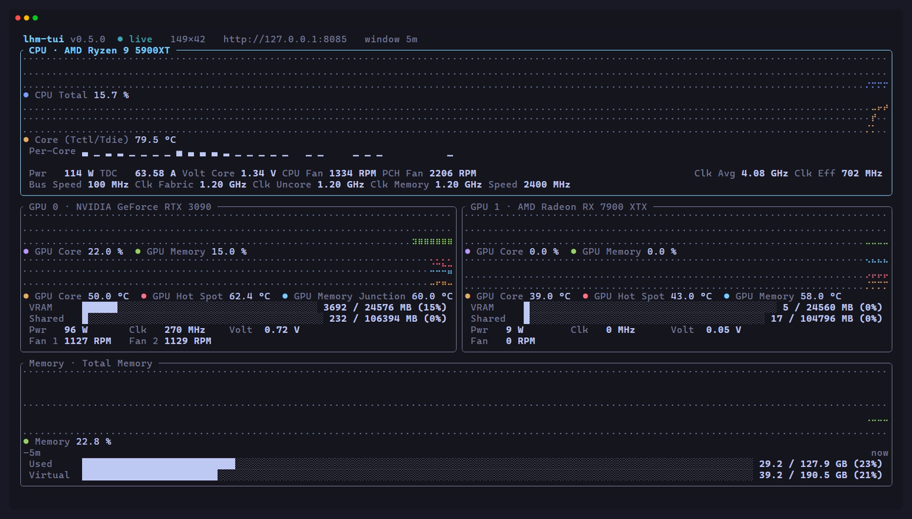
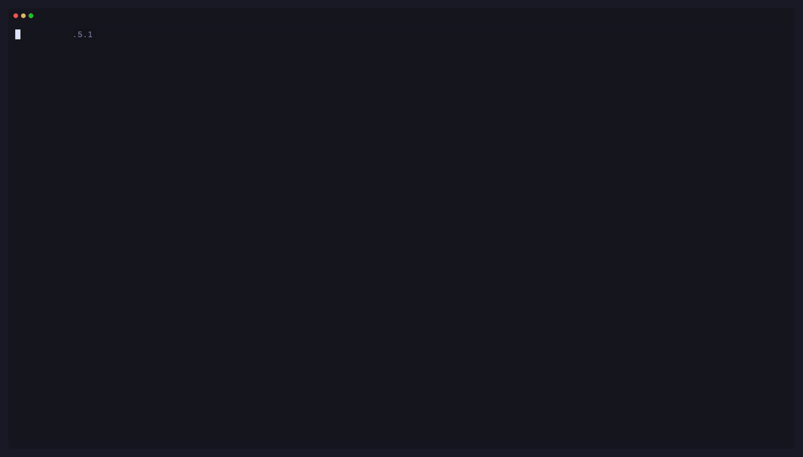

<div align="center">

# lhm-tui

**A btop-style terminal dashboard for LibreHardwareMonitor — CPU, GPU, temps, load and RAM, live in your terminal.**

[](https://github.com/baroseiro/lhm-tui/actions/workflows/ci.yml)
[](https://github.com/baroseiro/lhm-tui/releases/latest)
[](LICENSE)




</div>

`lhm-tui` reads LibreHardwareMonitor through either its built-in **Remote Web Server**
(plain HTTP) or — on Windows — by loading **`LibreHardwareMonitorLib.dll` directly**, so the LHM
application does not need to be running. Both sources render the same live, color-thresholded
panels in your terminal:

- **CPU** — temperature & total load gauges, `Per-Core`-labelled utilization bars, and a fixed
  two-row metrics strip (`Pwr · TDC · Volt Core · CPU Fan · PCH Fan` with `Clk Avg · Clk Eff`
  right-aligned; `Bus Speed · Clk Fabric · Clk Uncore · Clk Memory · Speed`, where `Speed` is the
  DDR transfer rate in MHz, twice the memory clock: `Speed 3600 MHz`) (`c` or `--charts` adds live
  graphs)
- **GPU** — one panel per GPU (NVIDIA/AMD/Intel, multi-GPU supported): core load, **VRAM usage**
  (`599 / 24576 MB (2%)`) with **shared GPU memory** (`Shared`) right below it (estimated from RAM
  minus VRAM when the card reports no total), hotspot temperature, power draw, clock & voltage, and
  every fan on the card on its own row underneath
- **Memory** — used and virtual-memory gauges with `used / total (pct %)` readouts, page file info
- **Temperatures** — sortable table of every thermal sensor in the tree, grouped per hardware
  device and colored by thresholds
- **Voltages** — sortable table of every voltage rail (`v`, hidden by default), grouped per hardware
  device; per-core rails appear when the panel is zoomed (`enter`)
- **Fans & controls** (`f`, hidden by default) — every fan in one flat table, with the device in
  parentheses (`GPU Fan 1 (NVIDIA GeForce RTX 3090)`), showing its **current speed** and **current
  setting**. LHM's `Default` mode is shown as `Auto`. Focus the panel with `Tab`, pick a fan with
  `↑`/`↓`, adjust it with `←`/`→` (±5 %) and press `0` for Auto/Default. Writes go only to
  fan/pump `Control` sensors
- Plus presets for **power**, **storage** and **network**
- **GPU fan anti-stop floor** (off by default; NVIDIA only) — keeps NVIDIA zero-RPM fan curves from
  parking the fans when idle: a 45 % floor while the GPU is idle, automatic driver control the
  moment load or temperature rises. Only NVIDIA cards whose fans *can* stop are touched; AMD/Intel
  cards and their vendor curves are never written to. Press `n` (or set
  `"fan_guard": { "enabled": true }`) to enable it
  ([SPEC §7.5](SPEC.md#75-gpu-fan-anti-stop-floor-off-by-default-nvidia-only))
- **Two data sources** — HTTP (default, local or remote) or the Windows DLL bridge
  (`--source dll --dll <LibreHardwareMonitorLib.dll>`) with LHM closed; both support fan writes,
  charts, history and all one-shot modes ([SPEC §3.6](SPEC.md#36-direct-dll-source-windows))

It's a single static binary and needs **no admin rights** in HTTP mode; it can monitor `localhost`
— or any Windows machine on your network / over SSH — through a small JSON config file. DLL mode
runs the hardware library inside the TUI's process tree, so run it elevated if you want LHM-level
sensor coverage.

> **Project status:** v0.5.0 — the direct DLL data source (Windows) is here: both the classic
> .NET Framework LHM zip and the .NET 8/9/10 zip work without running LHM. Recording and alerts
> remain the next v0.5.x milestone. The full design — architecture, config schema, chart engine,
> milestones — lives in [SPEC.md](SPEC.md).

## Demo

A ~17-second loop on the reference machine (RTX 3090 + RX 7900 XTX): the default gauges view with
shared GPU memory, `Per-Core` bars and the two-row CPU strip, `c` switching to live charts, `t`
opening the temperatures table, `v` opening the voltages table, `f` opening the fans & controls
table (focused and zoomed to show every device, speed and setting), `?` showing the key map, then a
clean quit. The fan anti-stop guard is off by default, so each GPU is on its own driver curve.



*Regenerate with [`vhs docs/demo.tape`](docs/demo.tape) (needs `vhs`, `ttyd`, `ffmpeg` and a running
LHM).*

---

## Requirements

| Component     | Requirement                                                                                   |
| ------------- | ---------------------------------------------------------------------------------------------- |
| Data source (HTTP) | [LibreHardwareMonitor](https://github.com/LibreHardwareMonitor/LibreHardwareMonitor) **0.9.5+** running as administrator, with **Options → Remote Web Server → Run** enabled |
| Data source (DLL) | Windows 10/11 and either LHM build: the **.NET Framework** zip (`LibreHardwareMonitor.zip`) or the **.NET 8/9/10** zip (`LibreHardwareMonitor.NET.10.zip`, needs its runtime). Point at it with `server.dll_path`/`--dll`; LHM does not need to be running. Run `lhm-tui` elevated for full sensor coverage |
| TUI client    | Windows 10/11, Linux or macOS. Windows Terminal recommended on Windows                          |
| Terminal size | ≥ 80×24 recommended (minimum 60×20)                                                              |

## Quick start

1. **Choose a data source.**
   - **HTTP (default, works remotely):** in LibreHardwareMonitor enable
     `Options → Remote Web Server → Run` ✓ (leave the port at `8085`), and tick the sensors you
     want under `File → Hardware`.
   - **DLL (Windows, LHM closed):** no server to enable. Point at either LHM build's library, e.g.
     `--dll "C:\Tools\LibreHardwareMonitor\LibreHardwareMonitorLib.dll"`; the .NET 10 build works
     through the bundled .NET bridge.
2. **Install `lhm-tui`** (pick one):

   ```powershell
   # Windows — download the zip from the latest release and put lhm-tui.exe on your PATH
   # https://github.com/baroseiro/lhm-tui/releases/latest

   # Any platform — install script (fetches the right build for you)
   # https://github.com/baroseiro/lhm-tui/releases/latest/download/lhm-tui-installer.ps1

   # Any platform — from source
   cargo install --git https://github.com/baroseiro/lhm-tui
   ```

   *winget, scoop and crates.io (`cargo install lhm-tui`) are planned for a v0.4.x follow-up.*
3. **Run it:**

   ```console
   # HTTP
   $ lhm-tui

   # Direct DLL (Windows; LHM may stay closed)
   $ lhm-tui --source dll --dll "C:\Tools\LibreHardwareMonitor\LibreHardwareMonitorLib.dll"
   ```

With no config file, `lhm-tui` polls `http://127.0.0.1:8085/data.json` every second.

> Monitoring a different machine? `lhm-tui --url http://192.168.1.42:8085` or set it once in the
> config file (see below). DLL mode is local to Windows by nature.

## Usage

```console
lhm-tui --help

  -c, --config <PATH>     Config file (JSON)
      --source <http|dll> Data source (default http)      [env: LHM_TUI_SOURCE]
      --dll <PATH>        LibreHardwareMonitorLib.dll or folder (DLL mode) [env: LHM_TUI_DLL]
      --url <URL>         LibreHardwareMonitor base URL   [env: LHM_TUI_URL]
      --username <USER>   Basic auth user                 [env: LHM_TUI_USERNAME]
      --password <PASS>   Basic auth password             [env: LHM_TUI_PASSWORD]
      --poll <DURATION>   Poll interval, e.g. 1s, 500ms
      --window <DURATION> Initial chart window, e.g. 5m
      --theme <NAME|PATH> Built-in theme or theme file
      --ascii             ASCII-only rendering
      --no-color          Disable colors (also honors NO_COLOR)
      --probe             Check connectivity, print LHM version & sensor counts, exit
      --once              Render one snapshot to stdout and exit
      --dump <PATH|->     Dump the normalized snapshot as JSON, exit
      --init-config       Write a default config file, exit
      --print-config      Print the effective merged config, exit
```

`--probe` is handy as a health check; `--once` / `--dump` make it scriptable.

### Keybindings

| Keys                  | Action                                  |
| --------------------- | --------------------------------------- |
| `q` / `Esc` / `Ctrl+C`| Quit                                    |
| `?` / `h`             | Help overlay — full key map             |
| `p` / `Space`         | Pause / resume polling                  |
| `g` / `G`             | Cycle chart window (1m · 5m · 15m)      |
| `Tab` / `Shift+Tab`   | Focus next / previous panel             |
| `↑` / `↓`             | Scroll table / move fan selection       |
| `Enter`               | Zoom focused panel fullscreen           |
| `b`                   | Sensor browser                          |
| `s`                   | Change table sort                       |
| `r`                   | Reload config from disk                 |
| `m`                   | Reset LHM min/max counters              |
| `a` / `d`             | ASCII mode / debug overlay              |
| `t` / `v`             | Toggle temperatures / voltages tables    |
| `f`                   | Toggle fans & controls table            |
| `c`                   | Toggle charts                           |
| `n`                   | Toggle GPU fan anti-stop floor (off by default; NVIDIA only) |
| `←` / `-`             | Fans panel: lower selected control by 5 % |
| `→` / `+`             | Fans panel: raise selected control by 5 % |
| `0`                   | Fans panel: back to Auto/Default         |

All keys are remappable in the config file. The overlay (`h` or `?`) shows the live key map for
your remaps, and the bottom line is a status line with the latest message (reload results, fan
anti-stop state, controls, errors) - the chart window label moved into the header.

**Mouse:** click a panel title to focus it; double-click the title to toggle zoom (same as `Enter`);
the scroll wheel scrolls the focused table or moves the fan selection, exactly like `↑`/`↓`.

## Configuration

`lhm-tui` looks for `lhm-tui.json` in the working directory, then in your platform config dir
(`%APPDATA%\lhm-tui\` on Windows, `~/.config/lhm-tui/` elsewhere). Generate a starting point with
`lhm-tui --init-config`. A fully commented example ships as
[`lhm-tui.example.json`](lhm-tui.example.json); the complete reference is in
[SPEC.md §8](SPEC.md#8-configuration).

```json
{
  "$schema": "./schema/lhm-tui.schema.json",
  "server": {
    "source": "http",
    "dll_path": null,
    "url": "http://127.0.0.1:8085",
    "poll_interval_ms": 1000
  },
  "ui": {
    "layout": ["cpu", "gpu", "memory", "thermal"]
  },
  "charts": {
    "enabled": true,
    "window": "5m",
    "window_cycle": ["1m", "5m", "15m"]
  },
  "theme": {
    "cpu": "#7aa2f7",
    "gpu": "#bb9af7",
    "memory": "#9ece6a",
    "warn": "#e0af68",
    "crit": "#f7768e",
    "thresholds": {
      "temperature": { "warn": 80, "crit": 95 }
    }
  }
}
```

Common things people change:

| I want to…                          | Config                                                                 |
| ----------------------------------- | ---------------------------------------------------------------------- |
| Monitor another machine             | `server.url` or `--url`                                                |
| Use the LHM DLL, no server running  | `"source": "dll"` + `server.dll_path`, or `--source dll --dll <path>`  |
| Use the web server's login          | `server.username` + `server.password_env` (read from an env var)       |
| Poll faster / slower                | `server.poll_interval_ms` (250–60000)                                  |
| Reorder / hide panels               | `ui.layout`, `panels.<name>.enabled`                                   |
| Pin a chart to a specific sensor    | `panels.sensor_overrides` with a `SensorId` (e.g. `/amdcpu/0/temperature/2`) |
| Build a custom panel                | `panels.custom` with `graph` / `gauge` / `table` widgets                |
| Change colors or warning thresholds | `theme`                                                                 |
| Remap keys                          | `keys`                                                                  |
| Turn charts on                      | Press `c`, run with `--charts`, or set `charts.enabled: true`          |
| Show the temperatures table         | Press `t`, or add `"thermal"` to `ui.layout`                            |
| Show the voltages table             | Press `v`, or add `"voltage"` to `ui.layout`                            |
| Show the fans & controls table      | Press `f`, or add `"fans"` to `ui.layout`                               |
| Change a fan/pump setting           | Focus the Fans panel (`Tab`), select with `↑`/`↓`, adjust with `←`/`→` (±5 %), `0` for Auto ([SPEC §6.3](SPEC.md#63-preset-panels)) |
| Keep NVIDIA idle fans spinning      | Off by default - press `n` or set `"fan_guard": { "enabled": true }`; AMD/Intel are never touched ([SPEC §7.5](SPEC.md#75-gpu-fan-anti-stop-floor-off-by-default-nvidia-only)) |
| Switch theme                        | `theme.name`: `default`, `gruvbox`, `nord` or `mono`                    |
| Custom theme file                   | `lhm-tui --theme path/to/theme.json` (same shape as the `theme` block)  |
| Strip all colors                    | `NO_COLOR=1 lhm-tui` or `--no-color`                                    |

CLI flags beat environment variables, which beat the config file.

## Remote monitoring & WSL2

LHM's web server binds where you tell it to. To watch a PC from another machine:

1. In LHM: `Options → Settings → Remote Web Server` → set the bind address to all interfaces
   (or the LAN IP) and **restart the server** when prompted.
2. Allow inbound TCP `8085` in Windows Defender Firewall.
3. Point `lhm-tui` at it: `lhm-tui --url http://192.168.1.42:8085`.

**WSL2 users:** `localhost` only reaches Windows if WSL is in
[mirrored networking mode](https://learn.microsoft.com/windows/wsl/networking#mirrored-mode-networking);
otherwise use the gateway IP (`ip route | grep default`) or the LAN IP.

The DLL source is local to the Windows machine running `lhm-tui`; use HTTP for remote monitoring.

## Troubleshooting

| Symptom                                  | Fix                                                                                       |
| ---------------------------------------- | ----------------------------------------------------------------------------------------- |
| `Cannot reach LHM at http://…:8085`      | Is LHM running **as administrator**? Is `Options → Remote Web Server → Run` checked? Restart the server after changing port/bind/auth. |
| `server.source = "dll"` on Linux/macOS  | DLL mode is Windows-only; use HTTP or run the TUI on the Windows host                       |
| `LibreHardwareMonitorLib.dll not found`  | Set `server.dll_path`/`--dll` to the DLL or its folder; null auto-detects next to the exe, Program Files and LocalAppData |
| `DLL bridge failed to load the library`  | Use an LHM build matching an installed runtime: the .NET Framework zip on a default Windows install, or the .NET 8/9/10 zip with its runtime; keep the dependency DLLs next to `LibreHardwareMonitorLib.dll` |
| .NET 10 LHM says "the .NET 8+ bridge is not available" | Rebuild with the .NET 8+ SDK available (`dotnet build`), or use the .NET Framework LHM build |
| DLL mode shows fewer sensors / zeros    | Run `lhm-tui` as administrator; MSR/SuperIO access needs elevation (same as LHM)            |
| DLL mode can't write fans                | Run elevated; the card exposes a `Controls` group only with the needed privileges            |
| `Authentication failed`                  | Credentials must match the username/password set in the LHM web server settings           |
| Panels but values look stale / missing   | Tick the hardware under `File → Hardware` in LHM; some sensors need admin rights           |
| Nothing but `—` on an NVIDIA laptop GPU   | Some mobile dGPUs only expose sensors while the GPU is active                              |
| Braille graphs look broken                | Press `a` for ASCII mode or set `charts.marker` to `halfblock` in the config               |
| Wrong sensor bound to a chart             | `lhm-tui --probe` prints the binding report; pin the sensor via `panels.sensor_overrides`  |
| `n` says "no controllable GPU fans"       | LHM needs to run as administrator so the `Controls` group exists (NVIDIA/AMD cards)        |
| A fan setting is rejected                 | LHM must run as administrator; some SuperIO headers expose a control without write support |
| AMD card untouched by the anti-stop floor | Expected: the guard is NVIDIA-only; AMD/Intel cards are never written to (SPEC §7.5)       |
| Anti-stop floor fights Afterburner/Adrenalin | Off by default; if you enable it, stop the vendor tool while the floor is active         |

Debug logging: `lhm-tui --log lhm-tui.log -v -v` (never writes into the TUI itself).

## Roadmap

- **v0.1.0** — dashboard: presets, optional braille charts, JSON config, themes, GPU fan anti-stop
  floor, installers via GitHub Releases
- **v0.1.x** — README captures, public repo, CI housekeeping (shipped alongside v0.2.0)
- **v0.2.0** — voltage & clock indicators: voltages table (`v`), GPU voltage on the metrics row,
  the CPU metrics strip
- **v0.3.0** — dashboard refinements: shared GPU memory row with a RAM-minus-VRAM fallback,
  dedicated GPU fan row, `Per-Core` bars, short metric labels, two-row CPU template, percentage
  memory readouts, better voltage names
- **v0.4.0** — fan/pump control from the Fans panel (flat, device in parentheses, speed + setting,
  Auto/Default), grouped temperature/voltage tables, mouse navigation and a CPU `Speed` readout
- **v0.4.1** — CPU/PCH fan readouts on the CPU strip, NVIDIA-only opt-in fan guard, schema and
  Windows config-path documentation fixes *(current)*
- **v0.4.x** — winget + scoop manifests, crates.io publish
- **v0.5.0** — direct DLL source (Windows; no LHM process), both the .NET Framework and .NET 10
  LHM builds, embedded bridges, same panels/charts/fan controls *(current)*
- **v0.5.x** — CSV/JSONL recording, threshold alerts, chart history backfill via LHM's `/metrics`
- **v0.6.0** — multi-host tabs, user theme files
- Later — template-based custom panels, plugin scripting

See [SPEC.md](SPEC.md) for the full design and milestone acceptance criteria.

## Building from source

```console
git clone https://github.com/baroseiro/lhm-tui
cd lhm-tui
cargo build --release        # binary in target/release/lhm-tui
cargo test                   # unit + integration + TUI snapshot tests
```

Long-run checks: `pwsh scripts/soak.ps1 -Minutes 30` (or `./scripts/soak.sh 30`) samples RSS/CPU
per minute into a CSV; the pre-release checklist lives in [`docs/qa-matrix.md`](docs/qa-matrix.md).

On Windows, `build.rs` compiles the embedded .NET Framework bridge with the `csc.exe` that ships
with the OS, and — when the .NET 8+ SDK is on `PATH` — the .NET 8/9/10 bridge with
`dotnet build`. If `csc.exe` is missing the build fails with an actionable message; set
`LHM_TUI_SKIP_BRIDGE=1` for an HTTP-only build. A missing .NET SDK only disables the .NET 10 LHM
build; the classic LHM zip still works. Non-Windows builds never include a bridge.

MSRV: Rust **1.89** (2021 edition, pinned by `rust-toolchain.toml`). Cross-compiles cleanly to
Linux/macOS for remote monitoring.

## Contributing

Issues and PRs are welcome — see [CONTRIBUTING.md](CONTRIBUTING.md) for the build/test loop and the
changelog rule. In short:

- Open an issue first for anything larger than a bug fix — the design decisions live in SPEC.md.
- Run `cargo fmt` and `cargo clippy --all-targets -- -D warnings` before pushing; CI runs both plus
  tests on Windows, Linux and macOS.
- Include the output of `lhm-tui --probe` (redact IPs/usernames) and your LHM version for bug reports.

## License

[MIT](LICENSE) © baroseiro

*Not affiliated with the LibreHardwareMonitor project. "LibreHardwareMonitor" is the work of its
respective authors; `lhm-tui` consumes its public HTTP API and, in DLL mode, loads its
MPL-2.0-licensed library at runtime without redistributing or modifying it.*
