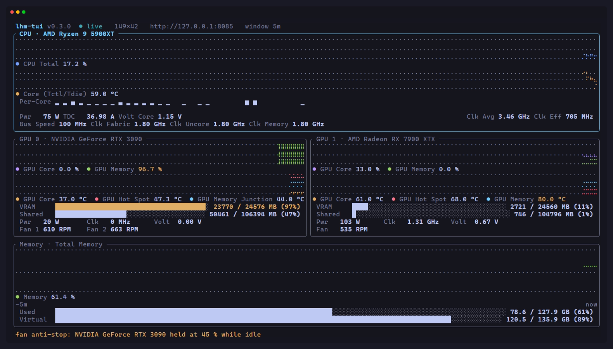
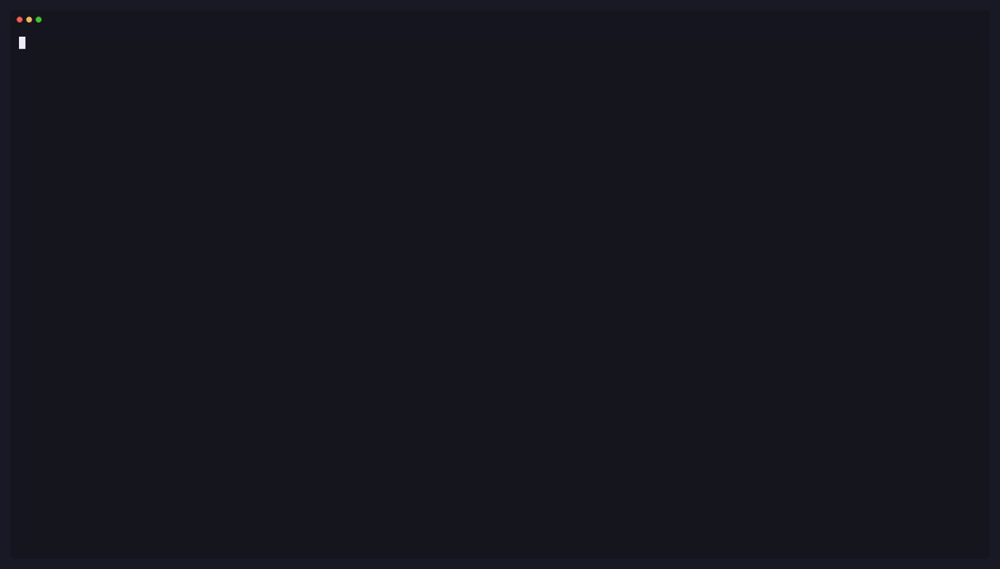

<div align="center">

# lhm-tui

**A btop-style terminal dashboard for LibreHardwareMonitor — CPU, GPU, temps, load and RAM, live in your terminal.**

[](https://github.com/baroseiro/lhm-tui/actions/workflows/ci.yml)
[](https://github.com/baroseiro/lhm-tui/releases/latest)
[](LICENSE)




</div>

`lhm-tui` talks to LibreHardwareMonitor's built-in **Remote Web Server** over plain HTTP and renders
live, color-thresholded panels in your terminal:

- **CPU** — temperature & total load gauges, `Per-Core`-labelled utilization bars, and a fixed
  two-row metrics strip (`Pwr · TDC · Volt Core` with `Clk Avg · Clk Eff` right-aligned; `Bus Speed ·
  Clk Fabric · Clk Uncore · Clk Memory`) (`c` or `--charts` adds live graphs)
- **GPU** — one panel per GPU (NVIDIA/AMD/Intel, multi-GPU supported): core load, **VRAM usage**
  (`599 / 24576 MB (2%)`) with **shared GPU memory** (`Shared`) right below it (estimated from RAM
  minus VRAM when the card reports no total), hotspot temperature, power draw, clock & voltage, and
  every fan on the card on its own row underneath
- **Memory** — used and virtual-memory gauges with `used / total (pct %)` readouts, page file info
- **Temperatures** — sortable table of every thermal sensor in the tree, colored by thresholds
- **Voltages** — sortable table of every voltage rail (`v`, hidden by default); GPU rails carry the
  card name, per-core rails appear when the panel is zoomed (`enter`)
- Plus presets for **fans**, **power**, **storage** and **network**
- **GPU fan anti-stop floor** (on by default) — keeps NVIDIA/AMD fan curves from parking the fans
  at zero-RPM when idle: a 45 % floor while the GPU is idle, automatic driver control the moment
  load or temperature rises. Only cards whose fans *can* stop are touched (detected from the fan
  control's software range), so an AMD that always turns is left alone. It is the only feature that
  writes to hardware, and only ever to the fan controls — press `f` or set
  `"fan_guard": { "enabled": false }` to turn it off
  ([SPEC §7.5](SPEC.md#75-gpu-fan-anti-stop-floor-on-by-default))

It's a single static binary, needs **no admin rights**, and can monitor `localhost` — or any
Windows machine on your network / over SSH — through a small JSON config file.

> **Project status:** v0.3.0 — dashboard refinements: shared GPU memory, a dedicated fan row,
> labelled per-core bars and compact metric labels. The full design — architecture, config
> schema, chart engine, milestones — lives in [SPEC.md](SPEC.md).

## Demo

A ~15-second loop on the reference machine (RTX 3090 + RX 7900 XTX): the default gauges view with
shared GPU memory, `Per-Core` bars and the two-row CPU strip, `c` switching to live charts, `t`
opening the temperatures table, `v` opening the voltages table, `?` showing the key map, then a
clean quit. Note the status line at the bottom — the fan anti-stop floor holding the 3090 at 45 %
while idle.



*Regenerate with [`vhs docs/demo.tape`](docs/demo.tape) (needs `vhs`, `ttyd`, `ffmpeg` and a running
LHM).*

---

## Requirements

| Component     | Requirement                                                                                   |
| ------------- | ---------------------------------------------------------------------------------------------- |
| Data source   | [LibreHardwareMonitor](https://github.com/LibreHardwareMonitor/LibreHardwareMonitor) **0.9.5+** running as administrator, with **Options → Remote Web Server → Run** enabled |
| TUI client    | Windows 10/11, Linux or macOS. Windows Terminal recommended on Windows                          |
| Terminal size | ≥ 80×24 recommended (minimum 60×20)                                                              |

## Quick start

1. **Enable the LHM web server** — in LibreHardwareMonitor:
   `Options → Remote Web Server → Run` ✓ (leave the port at `8085`).
   Optionally make sure the sensors you want are ticked under `File → Hardware`.
2. **Install `lhm-tui`** (pick one):

   ```powershell
   # Windows — download the zip from the latest release and put lhm-tui.exe on your PATH
   # https://github.com/baroseiro/lhm-tui/releases/latest

   # Any platform — install script (fetches the right build for you)
   # https://github.com/baroseiro/lhm-tui/releases/latest/download/lhm-tui-installer.ps1

   # Any platform — from source
   cargo install --git https://github.com/baroseiro/lhm-tui
   ```

   *winget, scoop and crates.io (`cargo install lhm-tui`) are planned for a v0.3.x follow-up.*
3. **Run it:**

   ```console
   $ lhm-tui
   ```

That's it — with no config file, `lhm-tui` polls `http://127.0.0.1:8085/data.json` every second.

> Monitoring a different machine? `lhm-tui --url http://192.168.1.42:8085` or set it once in the
> config file (see below).

## Usage

```console
lhm-tui --help

  -c, --config <PATH>     Config file (JSON)
      --url <URL>         LibreHardwareMonitor base URL   [env: LHM_TUI_URL]
      --username <USER>   Basic auth user                 [env: LHM_TUI_USERNAME]
      --password <PASS>   Basic auth password             [env: LHM_TUI_PASSWORD]
      --poll <DURATION>   Poll interval, e.g. 1s, 500ms
      --window <DURATION> Initial chart window, e.g. 5m
      --theme <NAME|PATH> Built-in theme or theme file
      --ascii             ASCII-only rendering
      --no-color          Disable colors (also honors NO_COLOR)
      --probe             Check connectivity, print LHM version & sensor counts, exit
      --once              Render one snapshot to stdout and exit
      --dump <PATH|->     Dump the normalized snapshot as JSON, exit
      --init-config       Write a default config file, exit
      --print-config      Print the effective merged config, exit
```

`--probe` is handy as a health check; `--once` / `--dump` make it scriptable.

### Keybindings

| Keys                  | Action                                  |
| --------------------- | --------------------------------------- |
| `q` / `Esc` / `Ctrl+C`| Quit                                    |
| `?` / `h`             | Help overlay — full key map             |
| `p` / `Space`         | Pause / resume polling                  |
| `g` / `G`             | Cycle chart window (1m · 5m · 15m)      |
| `Tab` / `Shift+Tab`   | Focus next / previous panel             |
| `Enter`               | Zoom focused panel fullscreen           |
| `b`                   | Sensor browser                          |
| `s`                   | Change table sort                       |
| `r`                   | Reload config from disk                 |
| `m`                   | Reset LHM min/max counters              |
| `a` / `d`             | ASCII mode / debug overlay              |
| `t` / `v`             | Toggle temperatures / voltages tables   |
| `c`                   | Toggle charts                           |
| `f`                   | Toggle GPU fan anti-stop floor (on by default) |

All keys are remappable in the config file. The overlay (`h` or `?`) shows the live key map for
your remaps, and the bottom line is a status line with the latest message (reload results, fan
anti-stop state, errors) — the chart window label moved into the header.

## Configuration

`lhm-tui` looks for `lhm-tui.json` in the working directory, then in your platform config dir
(`%APPDATA%\lhm-tui\` on Windows, `~/.config/lhm-tui/` elsewhere). Generate a starting point with
`lhm-tui --init-config`. A fully commented example ships as
[`lhm-tui.example.json`](lhm-tui.example.json); the complete reference is in
[SPEC.md §8](SPEC.md#8-configuration).

```json
{
  "$schema": "./schema/lhm-tui.schema.json",
  "server": {
    "url": "http://127.0.0.1:8085",
    "poll_interval_ms": 1000
  },
  "ui": {
    "layout": ["cpu", "gpu", "memory", "thermal"]
  },
  "charts": {
    "enabled": true,
    "window": "5m",
    "window_cycle": ["1m", "5m", "15m"]
  },
  "theme": {
    "cpu": "#7aa2f7",
    "gpu": "#bb9af7",
    "memory": "#9ece6a",
    "warn": "#e0af68",
    "crit": "#f7768e",
    "thresholds": {
      "temperature": { "warn": 80, "crit": 95 }
    }
  }
}
```

Common things people change:

| I want to…                          | Config                                                                 |
| ----------------------------------- | ---------------------------------------------------------------------- |
| Monitor another machine             | `server.url` or `--url`                                                |
| Use the web server's login          | `server.username` + `server.password_env` (read from an env var)       |
| Poll faster / slower                | `server.poll_interval_ms` (250–60000)                                  |
| Reorder / hide panels               | `ui.layout`, `panels.<name>.enabled`                                   |
| Pin a chart to a specific sensor    | `panels.sensor_overrides` with a `SensorId` (e.g. `/amdcpu/0/temperature/2`) |
| Build a custom panel                | `panels.custom` with `graph` / `gauge` / `table` widgets                |
| Change colors or warning thresholds | `theme`                                                                 |
| Remap keys                          | `keys`                                                                  |
| Turn charts on                      | Press `c`, run with `--charts`, or set `charts.enabled: true`          |
| Show the temperatures table         | Press `t`, or add `"thermal"` to `ui.layout`                            |
| Show the voltages table             | Press `v`, or add `"voltage"` to `ui.layout`                            |
| Keep GPU fans spinning when idle    | On by default — press `f` or `"fan_guard": { "enabled": false }` to disable ([SPEC §7.5](SPEC.md#75-gpu-fan-anti-stop-floor-on-by-default)) |
| Switch theme                        | `theme.name`: `default`, `gruvbox`, `nord` or `mono`                    |
| Custom theme file                   | `lhm-tui --theme path/to/theme.json` (same shape as the `theme` block)  |
| Strip all colors                    | `NO_COLOR=1 lhm-tui` or `--no-color`                                    |

CLI flags beat environment variables, which beat the config file.

## Remote monitoring & WSL2

LHM's web server binds where you tell it to. To watch a PC from another machine:

1. In LHM: `Options → Settings → Remote Web Server` → set the bind address to all interfaces
   (or the LAN IP) and **restart the server** when prompted.
2. Allow inbound TCP `8085` in Windows Defender Firewall.
3. Point `lhm-tui` at it: `lhm-tui --url http://192.168.1.42:8085`.

**WSL2 users:** `localhost` only reaches Windows if WSL is in
[mirrored networking mode](https://learn.microsoft.com/windows/wsl/networking#mirrored-mode-networking);
otherwise use the gateway IP (`ip route | grep default`) or the LAN IP.

## Troubleshooting

| Symptom                                  | Fix                                                                                       |
| ---------------------------------------- | ----------------------------------------------------------------------------------------- |
| `Cannot reach LHM at http://…:8085`      | Is LHM running **as administrator**? Is `Options → Remote Web Server → Run` checked? Restart the server after changing port/bind/auth. |
| `Authentication failed`                  | Credentials must match the username/password set in the LHM web server settings           |
| Panels but values look stale / missing   | Tick the hardware under `File → Hardware` in LHM; some sensors need admin rights           |
| Nothing but `—` on an NVIDIA laptop GPU   | Some mobile dGPUs only expose sensors while the GPU is active                              |
| Braille graphs look broken                | Press `a` for ASCII mode or set `charts.marker` to `halfblock` in the config               |
| Wrong sensor bound to a chart             | `lhm-tui --probe` prints the binding report; pin the sensor via `panels.sensor_overrides`  |
| `f` says "no controllable GPU fans"       | LHM needs to run as administrator so the `Controls` group exists (NVIDIA/AMD cards)        |
| AMD card untouched by the anti-stop floor | Expected: cards whose fan curve can never stop are skipped (`only_auto_stop`; SPEC §7.5)   |
| Anti-stop floor fights Afterburner/Adrenalin | Stop the vendor tool while the floor is enabled, or leave `fan_guard.enabled` off        |

Debug logging: `lhm-tui --log lhm-tui.log -v -v` (never writes into the TUI itself).

## Roadmap

- **v0.1.0** — dashboard: presets, optional braille charts, JSON config, themes, GPU fan anti-stop
  floor, installers via GitHub Releases
- **v0.1.x** — README captures, public repo, CI housekeeping (shipped alongside v0.2.0)
- **v0.2.0** — voltage & clock indicators: voltages table (`v`), GPU voltage on the metrics row,
  the CPU metrics strip
- **v0.3.0** — dashboard refinements: shared GPU memory row with a RAM-minus-VRAM fallback,
  dedicated GPU fan row, `Per-Core` bars, short metric labels, two-row CPU template, percentage
  memory readouts, better voltage names *(current)*
- **v0.3.x** — winget + scoop manifests, crates.io publish
- **v0.4.0** — full fan/pump control from the TUI (`Sensor?action=Set`) with confirmation dialogs
- **v0.5.0** — CSV/JSONL recording, threshold alerts, chart history backfill via LHM's `/metrics`
- **v0.6.0** — multi-host tabs, user theme files
- Later — template-based custom panels, plugin scripting

See [SPEC.md](SPEC.md) for the full design and milestone acceptance criteria.

## Building from source

```console
git clone https://github.com/baroseiro/lhm-tui
cd lhm-tui
cargo build --release        # binary in target/release/lhm-tui
cargo test                   # unit + integration + TUI snapshot tests
```

Long-run checks: `pwsh scripts/soak.ps1 -Minutes 30` (or `./scripts/soak.sh 30`) samples RSS/CPU
per minute into a CSV; the pre-release checklist lives in [`docs/qa-matrix.md`](docs/qa-matrix.md).

MSRV: Rust **1.89** (2021 edition, pinned by `rust-toolchain.toml`). Cross-compiles cleanly to
Linux/macOS for remote monitoring.

## Contributing

Issues and PRs are welcome — see [CONTRIBUTING.md](CONTRIBUTING.md) for the build/test loop and the
changelog rule. In short:

- Open an issue first for anything larger than a bug fix — the design decisions live in SPEC.md.
- Run `cargo fmt` and `cargo clippy --all-targets -- -D warnings` before pushing; CI runs both plus
  tests on Windows, Linux and macOS.
- Include the output of `lhm-tui --probe` (redact IPs/usernames) and your LHM version for bug reports.

## License

[MIT](LICENSE) © baroseiro

*Not affiliated with the LibreHardwareMonitor project. "LibreHardwareMonitor" is the work of its
respective authors; `lhm-tui` merely consumes its public HTTP API.*
